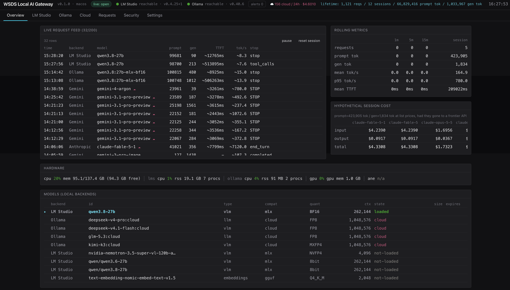
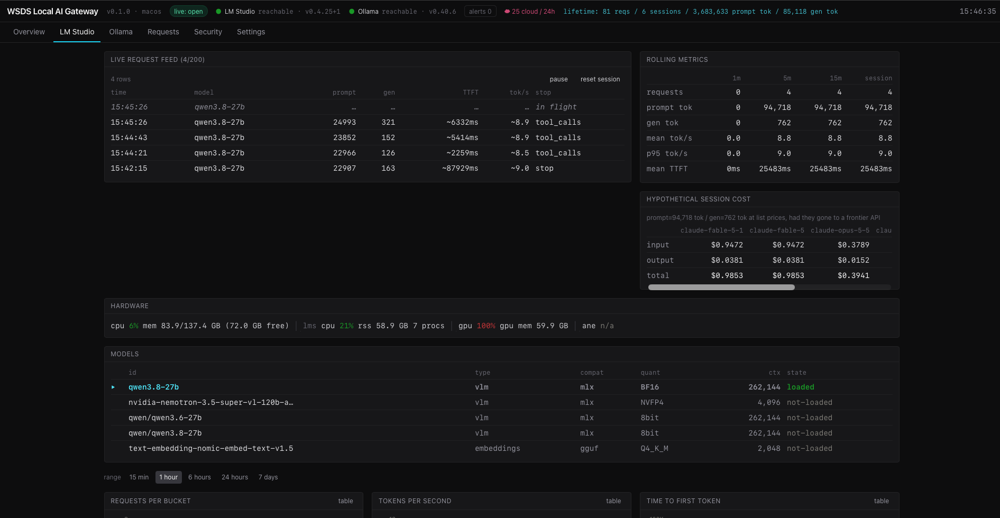
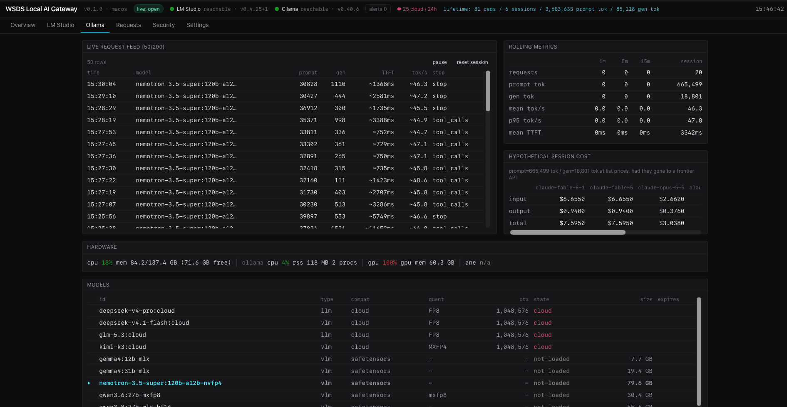
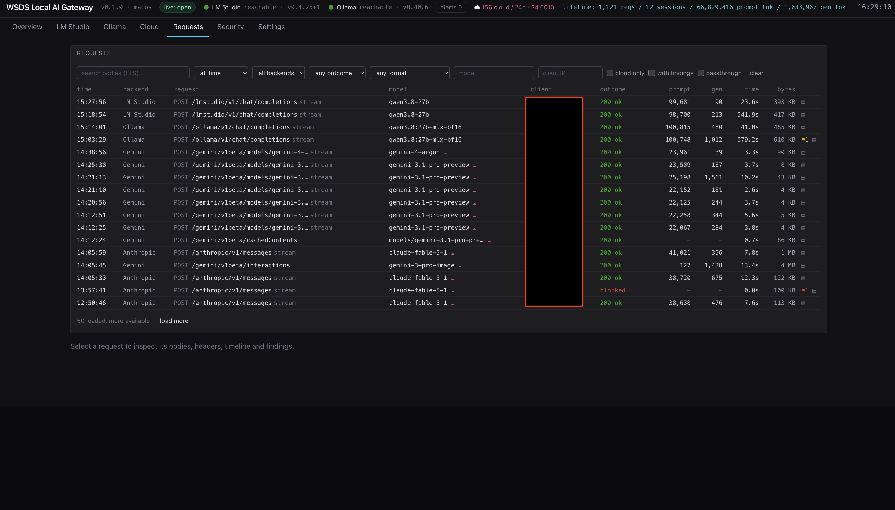
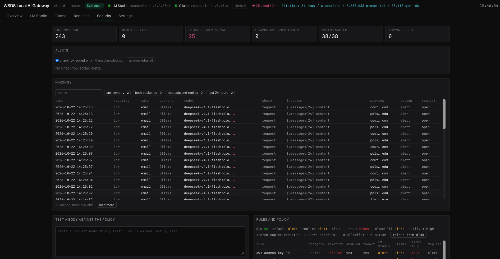
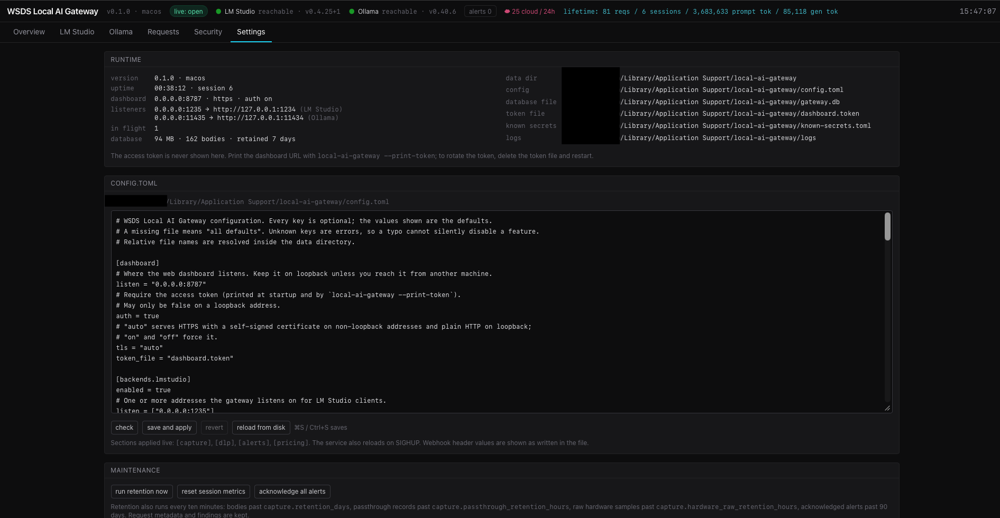

# WSDS Local AI Gateway

> **Development branch.** You are reading the `unified-router` branch, which adds the unified listener and the Anthropic, Gemini and OpenAI backends described below. It is still under test and may change or be rebased. For a working release use the `main` branch; this notice goes when the branch is merged.

A monitoring, inspection and data-loss-prevention reverse proxy for local LLM servers, with a web dashboard. It sits in front of **LM Studio** and **Ollama**, records every request's tokens, time to first token and throughput, prices them at frontier-API list rates, keeps a searchable copy of each request for debugging, scans prompts and replies for secrets and personal data, alerts you, and shows hardware telemetry, all from one binary. A unified listener routes by model name to those two servers or to **Anthropic**, **Gemini** and **OpenAI**, so the same scanning, recording and cost tracking covers the traffic that really leaves the machine.

It replaces the two terminal monitors it grew out of, [LMS-Monitor](https://github.com/Ward-Software-Defined-Systems/LMS-Monitor) and [Ollama-Monitor](https://github.com/Ward-Software-Defined-Systems/Ollama-Monitor).



## Features

- **Reverse proxy for both local backends.** One listener per backend, byte-transparent: clients see exactly what LM Studio or Ollama sent. Streams are teed, never buffered. WebSocket clients (the LM Studio SDK) are tunnelled.
- **One unified listener for everything.** A single port that picks the backend per request: an explicit prefix (`/anthropic/…`, `/openai/…`, `/gemini/…`, `/lmstudio/…`, `/ollama/…`), a provider-specific path (`/api/v0/*`, `/api/*`, `/v1beta/*`), the model (your aliases, the live LM Studio and Ollama model lists, a `provider/model` spelling, your prefix routes, then `claude-*`, `gemini-*` and `gpt-*`), a provider header, or the configured default. Standard paths stay standard, so a client only changes its base URL. Nothing is translated: each provider is reached in a format it speaks, and a mismatch is a clear 400.
- **Cloud providers as backends.** Anthropic, Gemini and OpenAI are reached over HTTPS with the client's own key, which the gateway forwards to the provider the request resolved to and never stores. Every request to them is cloud egress: scanned under the cloud policy, recorded with its bodies, and priced at the provider's list price as real spend. A header that belongs to another provider's API is refused before anything is sent.
- **Every API format parsed.** OpenAI chat, completions, embeddings and Responses; Anthropic Messages; Gemini `generateContent`, `streamGenerateContent` and `embedContent`; Ollama native chat, generate and embeddings; LM Studio native `/api/v0`. Tokens, time to first token, tokens per second and stop reasons per request; estimates are marked `~` when an engine gave no counts.
- **Overview, LM Studio, Ollama and Cloud tabs**: the live feed, loaded and cloud models, hardware (CPU, memory, GPU, and ANE power on macOS or VRAM on Linux), rolling 1m/5m/15m/session windows, hypothetical frontier cost for local traffic and real spend per provider for cloud traffic, charts.
- **Requests inspector**: keyset-paginated history with filters and full-text search over bodies, each request with its request and response bodies, reassembled reply text, headers, chunk timeline, findings, how it was routed, copy-as-curl and download.
- **DLP**: 38 built-in rules (cloud keys, tokens, private keys, JWTs, database URLs, payment cards, IBANs, social security numbers, emails, phones) plus your own regexes and exact known secrets. Findings carry a fingerprint and a masked preview, never the value. Stored copies are redacted. Requests to Ollama cloud models or to Anthropic, Gemini and OpenAI carrying a secret are **blocked** before they leave the machine.
- **Alerts**: in-app alert centre, desktop notifications (macOS and Linux desktops) and a webhook, throttled per rule so one noisy client cannot flood you. Backend outages and recoveries alert too.
- **Hot reload**: DLP rules, policy, alerts, capture limits and prices change without a restart, from the Settings tab or with SIGHUP.
- **Runs as a service**: a launchd agent on macOS, a systemd user unit on Linux, installed with one command.

## Platforms

macOS (Apple Silicon) and Ubuntu Linux (x86_64 with an NVIDIA GPU) are both supported and tested. GPU telemetry comes from `ioreg` on macOS and `nvidia-smi` on Linux; desktop notifications use `osascript` or `notify-send`; the service runs under launchd or systemd. The test suite needs no GPU, LM Studio or Ollama and runs on Linux in CI.

## Quick start

### Rust and Node

The gateway is a Rust program and its dashboard is built with Node, so both toolchains are needed on the machine that builds it. Check what is already there:

```sh
rustup --version    # rustup 1.28 or newer; the Rust version itself is pinned by this repository
node --version      # v24.x.x, the long-term-support line this project builds with
npm --version       # installed together with Node
make --version      # GNU Make, any version
```

`command not found` means a tool is missing; a Node older than 24 needs replacing. If all four look right, skip to the build.

**Rust.** Install it with rustup, the official installer, the same way on both platforms. A Rust from Homebrew or from `apt` is one fixed version that cannot follow `rust-toolchain.toml`, so remove it first (`brew uninstall rust`, or `sudo apt remove rustc cargo`); an old rustup is brought up to date with `rustup self update`.

```sh
curl --proto '=https' --tlsv1.2 -sSf https://sh.rustup.rs | sh    # accept the default installation
. "$HOME/.cargo/env"                                               # or open a new terminal
```

Inside the checkout, `rustup toolchain install` with no arguments reads `rust-toolchain.toml` and fetches exactly the pinned version with `rustfmt` and `clippy`; `cargo --version` then shows it. Building also needs a C compiler and linker: on macOS run `xcode-select --install` (which brings `git` and `make` too), on Ubuntu `sudo apt install build-essential curl git`.

**Node.** On macOS, download the LTS installer from [nodejs.org](https://nodejs.org/), or run `brew install node@24` and add the `PATH` line Homebrew prints at the end. On Ubuntu the distribution's own `nodejs` package is too old; add the NodeSource repository for Node 24, which `apt` then keeps up to date:

```sh
curl -fsSL https://deb.nodesource.com/setup_24.x -o nodesource_setup.sh
sudo -E bash nodesource_setup.sh && rm nodesource_setup.sh
sudo apt install -y nodejs                                         # npm comes with it
```

On either platform, [nvm](https://github.com/nvm-sh/nvm) (`nvm install 24`) keeps Node in your home directory and needs no root. Run the version checks again before building.

### Build and run

```sh
make release                                  # builds the dashboard, then the binary with it embedded
mkdir -p ~/.local/bin                         # the usual place for your own binaries; see the PATH note below
install -m 755 target/release/local-ai-gateway ~/.local/bin/
local-ai-gateway config init                  # writes a commented config.toml with every default
local-ai-gateway                              # prints the dashboard URL with its access token
```

`~/.local/bin` has to be on your `PATH` for the last two commands to find the binary. Ubuntu's default shell profile adds the directory on your next login once it exists, so log out and in again or run `source ~/.profile`. macOS does not add it: run `echo 'export PATH="$HOME/.local/bin:$PATH"' >> ~/.zshrc` once and open a new terminal. The service installed below records the binary's absolute path and does not depend on `PATH`.

Open the printed URL once; it sets a cookie and redirects to the clean address. Later, `local-ai-gateway --print-token` prints it again.

To run it at login:

```sh
local-ai-gateway service install              # launchd agent (macOS) or systemd user unit (Linux)
local-ai-gateway service status
local-ai-gateway setup check                  # configuration, file modes, backends, listeners, tools
```

On a headless Linux server run `loginctl enable-linger $USER` once so the user unit outlives your login session. Set `[dashboard] listen = "0.0.0.0:8787"` there; the dashboard then serves HTTPS with a self-signed certificate.

### Pointing clients at the gateway

The backends keep their own ports; the gateway listens on its own (defaults `127.0.0.1:1235` for LM Studio and `127.0.0.1:11435` for Ollama; set `listen` under `[backends.<name>]` to taste, `0.0.0.0` to serve other machines). Anything that still talks to a backend directly is invisible to the gateway.

| Client | Setting |
|---|---|
| OpenAI-compatible SDKs and tools | `OPENAI_BASE_URL=http://<host>:11435/v1` (Ollama) or `http://<host>:1235/v1` (LM Studio) |
| Ollama CLI and native clients | `OLLAMA_HOST=<host>:11435` |
| Anthropic-format clients | `ANTHROPIC_BASE_URL=http://<host>:11435` or `http://<host>:1235` |
| LM Studio SDK | `new LMStudioClient({ baseUrl: "ws://<host>:1235" })` |

The `lms` CLI talks to LM Studio's internal port and is unaffected.

### The unified listener

`[unified]` listens on `127.0.0.1:4000` by default and serves every enabled backend, the three cloud providers included. Point a client's base URL at it and keep the standard paths; the model decides where the request goes. An agent application that speaks the standard Anthropic, Gemini and OpenAI-compatible endpoints needs nothing but its base URLs changed:

| Client | Setting |
|---|---|
| Anthropic-format clients | `ANTHROPIC_BASE_URL=http://<host>:4000` (`claude-*` models go to Anthropic, local model ids to the server that lists them) |
| Gemini-format clients | base URL `http://<host>:4000/v1beta` (the `/v1beta/*` paths always go to Gemini) |
| OpenAI-compatible SDKs and tools | `OPENAI_BASE_URL=http://<host>:4000/v1` (`gpt-*` to OpenAI; `claude-*` and `gemini-*` through those providers' OpenAI-compatible endpoints; local ids to LM Studio or Ollama) |
| Ollama CLI and native clients | `OLLAMA_HOST=<host>:4000` (`/api/*` always goes to Ollama) |
| Forcing a target | prefix the path: `http://<host>:4000/anthropic/v1/messages`, `/openai/v1/…`, `/gemini/v1beta/…`, `/lmstudio/api/v0/…`, `/ollama/api/…` |
| Aliases | `[unified.aliases] fast = "ollama/gemma4:12b-mlx"`; the client asks for `fast`, the gateway rewrites the model for Ollama |

Clients send their own provider keys, as they do today; the gateway forwards a key only to the provider the request resolved to. `GET /v1/models` on the unified port answers with the local servers' models and your aliases merged into one OpenAI-style list, unless a provider header (`anthropic-version`, `x-goog-api-key`, `openai-organization`) names a provider, in which case that provider's list is fetched. Requests that no rule decides go to `default_backend` (LM Studio); the prefix is the escape hatch. WebSocket upgrades are tunnelled to local backends only, since a tunnel cannot be scanned. Every response from a proxy listener, the per-backend ones included, carries `x-local-ai-gateway: <version>`, so a client can check that it is talking to the gateway before it routes provider traffic through it; an agent application can do that with one `GET /v1/models` against the unified port.

### HTTPS on the listeners

The proxy listeners speak plain HTTP by default, which is fine on loopback. Clients on other machines send bearer tokens and provider keys with every request, so give a listener HTTPS by setting `tls = "on"` (or `"auto"`, which is on for non-loopback addresses) in its section:

```toml
[unified]
listen = ["0.0.0.0:4000"]
tls = "on"

[tls]
sans = ["gateway.lan", "192.168.1.10"]      # the names and addresses clients use, besides localhost and the host name
```

The gateway runs its own certificate authority. The first start mints `tls/ca.pem` and `tls/ca-key.pem` in the data directory; every start then issues a fresh server certificate (`tls/cert.pem`, `tls/key.pem`) under it for `localhost`, the loopback addresses, the machine's host name, the specific addresses of the TLS listeners and the names in `[tls] sans`, valid 820 days. The dashboard's certificate comes from the same CA. Trust the CA once per machine or application and every listener, present and future, is covered:

```sh
local-ai-gateway tls ca-cert > local-ai-gateway-ca.pem     # or download it from the Settings tab
local-ai-gateway tls show                                  # fingerprint, certificate names, https listeners
# macOS, for every application that uses the system trust store (the login keychain asks for your password):
security add-trusted-cert -r trustRoot -k ~/Library/Keychains/login.keychain-db local-ai-gateway-ca.pem
# Ubuntu, system wide:
sudo cp local-ai-gateway-ca.pem /usr/local/share/ca-certificates/local-ai-gateway.crt && sudo update-ca-certificates
# Per application instead: Node NODE_EXTRA_CA_CERTS=<file>, Python REQUESTS_CA_BUNDLE=<file> or SSL_CERT_FILE=<file>, curl --cacert <file>
```

Then use `https://` (and `wss://` for the LM Studio SDK) in the client settings above. Compare the fingerprint `tls show` prints with the one your trust store shows before you trust it. The CA key is as sensitive as the access token: whoever holds it can impersonate the gateway to every client that trusts the CA.

## The dashboard

| Tab | What it shows |
|---|---|
| Overview | every backend: feed, models, hardware, rolling metrics, cost, charts |
| LM Studio, Ollama | the same, for one local backend |
| Cloud | Anthropic, Gemini and OpenAI together: feed, rolling metrics, spend per provider at list price and a cumulative spend chart |
| Requests | the history with filters and search; a request's bodies, headers, timeline, findings and how it was routed |
| Security | findings and alerts of the last 24 hours, the alert centre, every rule with its effective policy per backend, a test box, the cloud-egress counter |
| Settings | runtime facts and paths (every listener and what it reaches), the `config.toml` editor (check, save and apply, reload), maintenance |

The status bar shows backend reachability and versions, the live-socket state, unacknowledged alerts, cloud requests and spend in the last 24 hours and the lifetime totals. The feed can be paused (`PAUSED`) and the session metrics reset, as in the terminal monitors.











## Configuration

`config.toml` lives in the data directory: `~/Library/Application Support/local-ai-gateway/` on macOS, `~/.config/local-ai-gateway/` on Linux (data under `~/.local/share/local-ai-gateway/`). `--data-dir` moves everything, `--config` just the file; `LAIG_CONFIG`, `LAIG_DATA_DIR`, `LAIG_DASHBOARD_LISTEN`, `LAIG_DASHBOARD_TOKEN` and `LAIG_LOG` stand in for the flags. Every key is optional and unknown keys are errors. `local-ai-gateway config init` writes a commented file with every default; `--check-config` validates one.

| Section | Keys | Reload |
|---|---|---|
| `[dashboard]` | `listen`, `auth`, `tls` (`auto`, `on`, `off`), `token_file` | restart |
| `[backends.lmstudio]`, `[backends.ollama]`, `[backends.anthropic]`, `[backends.gemini]`, `[backends.openai]` | `enabled`, `listen` (list; empty for a backend reached through the unified listener only, the cloud providers' default), `upstream` (`https://` off loopback for a cloud provider), `capture_bodies`, `record_passthrough`, `rewrite_include_usage`, `tls` (`off`, `on`, `auto`; HTTPS on this backend's listeners), `poll_interval_secs` (local only); LM Studio: `lms_bin`, `app_path` | restart |
| `[unified]` | `enabled`, `listen` (list), `tls` (`off`, `on`, `auto`), `default_backend`, `aliases` (name → `provider/model` or model), `[[unified.routes]]` (`model_prefix`, `backend`) | `listen`, `enabled` and `tls` restart; the rest live |
| `[tls]` | `sans` (DNS names or IP addresses added to the server certificate) | restart |
| `[capture]` | `max_body_bytes`, `retention_days`, `passthrough_retention_hours`, `hardware_raw_retention_hours`, `max_buffered_request_bytes` | live |
| `[dlp]`, `[dlp.cloud]`, `[dlp.rules.<id>]`, `[dlp.backends.<name>]`, `[[dlp.custom_rules]]`, `[[dlp.allowlist]]` | see below | live |
| `[alerts]`, `[alerts.desktop_notification]`, `[alerts.webhook]` | `throttle_secs`; `enabled`, `min_severity`; `url`, `headers` or `headers_file`, `timeout_secs` | live |
| `[pricing.providers.<p>.models.<key>]` | `input_per_mtok_usd`, `output_per_mtok_usd` | live |
| `[hardware]` | `enabled`, `sample_interval_secs`, `gpu_source`, `powermetrics` | restart |
| `[log]` | `level`, `max_files` | restart |

"Live" sections apply when you save in the Settings tab, call `POST /api/config/reload`, or send `SIGHUP`. The Settings tab shows which sections still need a restart.

`rewrite_include_usage` adds `stream_options.include_usage` to streaming chat and completion requests (`/v1/chat/completions`, `/v1/completions` and LM Studio's `/api/v0/chat/completions`). LM Studio sends no token counts on a stream without it, and neither do Anthropic's and Gemini's OpenAI-compatible endpoints; Ollama sends them either way; so it is on for every backend. On the per-backend listeners it is the only change the gateway makes to a request. The unified listener also strips an explicit `/anthropic/`-style prefix from the path, rewrites `model` when an alias or a `provider/model` spelling resolved it, sends OpenAI-format requests for Gemini to `/v1beta/openai/…`, and removes `accept-encoding` from requests to cloud providers so their answers arrive uncompressed and can be parsed. Everything else is forwarded byte for byte.

## DLP

Every inference request body is scanned before it is forwarded: JSON bodies leaf by leaf (a finding says `$.messages[3].content`), anything else as text. The reply text is scanned when the response ends. A finding records the rule, severity, location, a 32-character fingerprint and a masked preview (`AKIA…MPLE`); the plaintext is never stored, logged or shown. Stored copies replace each value with `[REDACTED:<rule>:<fingerprint>]`, so a redacted JSON body stays valid JSON.

**Actions.** A request-side finding is `record` (kept in the Security tab), `alert` (also notified) or `block` (refused with 403 and a `x-gateway-blocked: dlp` header; the backend never sees it). Replies can be `record` or `alert`. The order of precedence is the rule's own default, `[dlp] default_action`, `[dlp.backends.<name>]`, `[dlp.rules.<id>]`, then the cloud override: a request routed to an Ollama cloud model or to Anthropic, Gemini or OpenAI takes the stricter of its action and `[dlp.cloud] request_action` (`block` by default; `pii_action` for personal data). Secret rules default to the global action; PII rules record (email, phone) or alert (payment card, IBAN, social security number). On a cloud provider every request with a body is scanned, not only the inference formats: Gemini's cached-content creation, Anthropic's token counting and uploads carry prompts too, and they are recorded with their bodies as `cloud_passthrough`.

**Rules.** The 38 built-in rules cover AWS, GitHub, GitLab, Slack, Stripe, Google, GCP service accounts, Anthropic, OpenAI, Hugging Face, npm, PyPI, Twilio, SendGrid, Mailgun, Azure storage, DigitalOcean and Telegram credentials, PEM and OpenSSH private keys, age keys, JWTs, generic `password =` style assignments with high entropy, database and basic-auth URLs with embedded passwords, bearer tokens, and the PII rules. Each has a positive and a negative test vector. Add your own with `[[dlp.custom_rules]]` (regex crate syntax, optional capture group, keywords and entropy gate); disable, re-severity or re-action a rule with `[dlp.rules.<id>]`; exempt values with `[[dlp.allowlist]]` by rule, regex, fingerprint, direction or backend. Local dummy keys such as `sk-lm-studio` or `ollama` are allowlisted out of the box.

**Known secrets.** Put exact values in `known-secrets.toml` in the data directory (mode 0600):

```toml
[[secret]]
kind = "vault-root-token"
value = "hvs.…"
```

They are matched raw, percent-encoded, base64 (standard and URL-safe) and as a bare `Bearer` token, and reported by kind. The file is read at start and on every reload.

**Test box.** The Security tab scans pasted text under the live policy and shows what would be found, whether it would be blocked, and what the stored copy would look like. Nothing entered there is stored or logged.

## Alerts

A request's findings become one alert when they reach `notify_min_severity` (`high` by default) or the request was blocked. Backends that fail three polls in a row raise an alert; recovery raises another. Every alert goes to the in-app list; desktop notifications (`osascript` on macOS, `notify-send` on a Linux desktop) and the webhook (a JSON `POST` with `kind`, `severity`, `title`, `detail`, `request_id`, `created_at`, plus your headers) are throttled to one per `throttle_secs` per rule, kind and backend, with the suppressed count attached to the next one. Notification text carries masked fields only. Webhook header values can live in a separate `headers_file` (mode 0600) so they never appear in the config editor.

## API

Every dashboard endpoint is under `/api`, JSON, gated by the token cookie (or `?token=`). Errors are `{"error": {"code", "message"}}`.

| Endpoint | Purpose |
|---|---|
| `GET /api/status` | version, platform, session, listeners, backends, database, DLP summary, paths |
| `GET /api/models?backend=` | the unified model list |
| `GET /api/hardware/current`, `GET /api/hardware/series?from&to` | telemetry |
| `GET /api/metrics/rolling`, `/series?metric=`, `/cost`, `/spend?from&to`, `/lifetime` | metrics; `backend=` or `group=local\|cloud` scopes them; `spend` is what each cloud provider charged at list price |
| `GET /api/requests?cursor&limit&backend&group&model&outcome&format&client&cloud&has_findings&from&to&q&include_passthrough` | history (`q` is full-text search) |
| `GET /api/requests/inflight`, `GET /api/requests/{id}`, `GET /api/requests/{id}/body/{request\|response}`, `DELETE /api/requests/{id}/bodies` | one request |
| `GET /api/findings?rule&severity&backend&direction&from&to&before&limit` | findings |
| `GET /api/alerts?unacked&before&limit`, `POST /api/alerts/{id}/ack`, `POST /api/alerts/ack-all` | alerts |
| `GET /api/dlp/rules`, `POST /api/dlp/test {text, backend, is_cloud}`, `POST /api/dlp/reload` | DLP |
| `GET /api/config`, `GET /api/config/file`, `POST /api/config/validate {text}`, `PUT /api/config {text}`, `POST /api/config/reload` | configuration |
| `POST /api/session/reset`, `POST /api/retention/run`, `GET /api/sessions` | housekeeping |
| `GET /api/tls/ca` | the CA certificate as a PEM download |
| `GET /ws` | the event stream: `hello`, then every event (`request_started`, `request_completed`, `finding`, `alert`, `backend_snapshot`, `hardware`, `metrics`, `config_changed`, `shutdown`) |

## Files

| File | Purpose |
|---|---|
| `config.toml` | configuration (optional) |
| `gateway.db` (+ `-wal`, `-shm`) | SQLite: requests, bodies (full-text indexed), findings, alerts, hardware samples, rollups |
| `dashboard.token` | the access token, mode 0600 |
| `tls/ca.pem`, `tls/ca-key.pem` | the gateway's certificate authority: import `ca.pem` into clients; the key is mode 0600 and never leaves the machine |
| `tls/cert.pem`, `tls/key.pem` | the server certificate every HTTPS listener serves, reissued at every start |
| `known-secrets.toml` | exact values to watch for, mode 0600 |
| `logs/local-ai-gateway.YYYY-MM-DD.log` | the daily log; `logs/service.*.log` under launchd |

Request metadata and findings are kept indefinitely; bodies expire after `retention_days` (7), passthrough rows after 24 hours, raw hardware samples after 48 hours, acknowledged alerts after 90 days.

## Project structure

| Path | Role |
|---|---|
| `crates/gateway-core` | types, configuration, paths, event bus, rolling aggregation, pricing, the routing table, the SQLite store |
| `crates/gateway-proxy` | listeners (fixed and unified), route classifier and resolver, request and response pipelines, stream parsers, WebSocket tunnel |
| `crates/gateway-dlp` | rules, known secrets, scanning, redaction, policy |
| `crates/gateway-backends` | LM Studio and Ollama clients and pollers |
| `crates/gateway-hardware` | sysinfo, ioreg, nvidia-smi, powermetrics |
| `crates/local-ai-gateway` | the binary: CLI, wiring, hot reload, alerts, web layer, service and setup commands |
| `frontend/` | the dashboard (Vite, React, TypeScript, Tailwind), embedded into the binary at build time |
| `fixtures/` | real captures the parsers are tested against |

`make test` runs what CI runs: `cargo fmt --check`, `cargo clippy -D warnings`, `cargo test`, and the frontend typecheck and lint.

## Security notes

- The dashboard binds to loopback by default and requires the access token; `auth = false` is only accepted on loopback. Off loopback, `tls = "auto"` serves HTTPS with a certificate from the gateway's own CA.
- Proxy listeners can serve HTTPS too (`tls` under `[backends.<name>]` and `[unified]`), with a certificate from the same CA; plain HTTP off loopback draws a warning at startup and in `setup check`. Trust the CA, never one certificate: the server certificate changes at every start. The CA key, `tls/ca-key.pem`, is as sensitive as the access token.
- Proxy listeners carry no authentication, like the backends behind them. Bind them to loopback unless other machines need them, and consider setting LM Studio's network interface to `127.0.0.1` so nothing bypasses the gateway.
- Every response from a proxy listener carries `x-local-ai-gateway: <version>`, the gateway's own value whatever an upstream sent, so a client can verify it is talking to the gateway before routing provider traffic through it.
- Provider keys are the clients' own. The gateway holds none, forwards a key only to the provider the request resolved to, refuses a request whose headers belong to another provider's API, and never follows a redirect from a cloud provider (the client gets the 3xx instead). A cloud provider's `upstream` must be `https://` unless it is on loopback.
- No request or response body, header value or access token is ever written to the log. Bodies reach only the database, DLP-redacted; `authorization`, `x-api-key`, `x-goog-api-key`, `cookie` and `proxy-authorization` header values are redacted in stored copies, and credential query parameters (`key`, `api_key`, `token`, …) are redacted in the stored query and in logged URLs.
- The database is not encrypted. It holds prompts; treat the data directory accordingly.
- Blocking happens on the request side only. A secret in a model's reply is recorded and alerted, never cut from the stream.

## Moving over from the monitors

1. Stop LMS-Monitor and Ollama-Monitor (the latter held port 11435, which the gateway's Ollama listener takes over by default).
2. Set `listen` and `upstream` for each backend in `config.toml`, then `local-ai-gateway --check-config`.
3. `local-ai-gateway service install`, then `setup check`.
4. Repoint clients per the table above and send one request per client type; confirm the rows in the Requests tab.
5. Keep the monitors' `usage.db` files; importing them is on the roadmap.

## Known issues

- LM Studio reports zero prompt tokens for embeddings (`usage.prompt_tokens: 0`), so embedding requests on that backend show no prompt count.
- LM Studio's native streaming endpoint carries no engine `stats` (tokens per second, time to first token); those arrive on non-streaming `/api/v0` requests only. Streams get the gateway's wall-clock figures, marked `~`.
- LM Studio 0.4.25 refuses an oversized prompt without saying how long it was, so a rejected row shows the loaded context length (taken from the model list) and no input count. The refusal is HTTP 400 on the chat and completion routes, 500 on `/v1/messages` and `/v1/responses`, and an error event inside a 200 stream when streaming; all are recorded as `rejected`.
- An error inside a 2xx stream is recorded as `failed` with the 200 status the client already received.
- Open streams that outlive the five-second shutdown grace are cut without a record.
- Reply text is scanned once at the end of the response, not incrementally.
- Changing a backend's `capture_bodies`, `record_passthrough` or `rewrite_include_usage` needs a restart.
- There is no OpenAI capture: the OpenAI shapes are tested on the LM Studio, Ollama, Anthropic and Gemini captures.
- Spend is flat list price per token. Gemini's image models bill images as output tokens at a rate of their own, and `pricing.toml` carries that rate for them, so an image answer is priced right and any text or thinking tokens from those models are overpriced. Gemini 3.5 Flash and 3.7 Flash have no row because Google's pricing page does not list them; add one under `[pricing.providers.google.models]` when you know the rate. Gemini 4 Argon is listed at its price until 30 November 2026; Google doubles it from 1 December 2026.
- A Gemini stream requested without `alt=sse` is a JSON array; it is parsed once it is complete, so its figures arrive at the end.
- The cloud providers are not polled: no reachability, version or model list for them in the dashboard, and the merged `GET /v1/models` answer lists only the local servers' models and your aliases. That answer is gateway-generated and not recorded.
- A model-less request with a body and no provider header goes to `default_backend`; use a prefix to force the target.
- Real spend uses flat list prices: cache discounts and long-context tiers are not applied, so it is an upper bound (a lower one for Claude Haiku 5.5 and Gemini 3.1 Pro past their prompt-size thresholds). Ollama `:cloud` models have no price.
- WebSocket APIs of the cloud providers (Gemini Live, OpenAI Realtime) are refused on every listener.
- The database is schema v2 since the cloud providers arrived; an older gateway build cannot read rows that name them.
- The server certificate is issued at start and valid 820 days; a gateway that runs longer than that without a restart serves an expired certificate until it is restarted. Changing `tls` or `[tls] sans` needs a restart for the same reason.
- A build from before the CA replaces the dashboard's old self-signed certificate on its first start. A browser that trusted that one certificate asks again; trust the CA instead.

## Roadmap

Format translation between provider APIs · per-client API keys and policy, and gateway-held provider keys · import of the monitors' `usage.db` histories · model management (load, unload, pull, keep-alive countdown) · Prometheus `/metrics` · bypass detection via `lms log stream` · stopping a reply stream on a finding · encrypted database · Intel and AMD GPU telemetry on Linux.

## Licence

Proprietary, see [LICENSE](LICENSE). Personal evaluation and non-commercial experimentation are permitted; commercial use needs a separate licence from Ward Software Defined Systems LLC.
